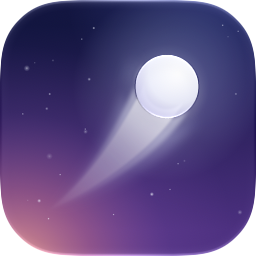

<p align="center"></p>

<h1 align="center">LaunchDeck</h1>

<p align="center">为 macOS 26+ 重新做的启动台：保留原版启动台的全部用法，加上玻璃质感和跟随指针的光效。</p>

macOS 26 去掉了启动台。LaunchDeck 是一个原生（AppKit + Core Animation + SwiftUI）的替代品：四指捏合呼出，分页网格，文件夹，拖拽整理，打字搜索，都和原来一样顺手。

## 功能

**原版启动台的一切**
- **四指捏合**（拇指加三指）打开，**张开**关闭；界面跟着手指的动作逐渐出现或消失。点 Dock 图标也能开关
- 全屏覆盖在模糊的桌面壁纸上，所有桌面空间、全屏应用之上都可用
- 7×5 分页网格：触控板左右滑动（带惯性与边缘回弹），鼠标滚轮、页码圆点也能翻页
- **文件夹**：把一个图标拖到另一个上停一下就合成文件夹，名字按类别自动取；拖到已有文件夹上直接松手即可放入。打开时应用从文件夹预览里飞出、面板从图标原位展开，关闭时再飞回去；点标题改名，拖过面板边缘就能把应用拖出来
- **拖拽排序**：其他图标自动让位；拖到屏幕边缘停一下翻页；整理时图标抖动，点空白处或按 Esc 结束
- 第一次打开时自动排好：系统应用在第一页，实用工具收进“其他”文件夹，第三方应用按类别（游戏、效率、开发工具……）归入文件夹
- 新安装的应用名字前有蓝点，打开一次后消失

**更顺手的地方**
- **拼音搜索**：`weixin`、`wx` 都能找到微信；中文名在英文系统下也能搜。直接打字即可，不会弹出输入法候选框
- 常用的应用在搜索结果里排得更靠前
- 正在运行的应用下方有小圆点
- 右键应用：打开 / 在访达中显示 / 从启动台隐藏（隐藏后不占网格位置，搜索仍能找到）
- 键盘：方向键或 Tab 选择，回车打开，Esc 清空、关闭或取消拖拽，⌥⌫ / ⌘⌫ 删除，⌘V 粘贴
- **菜单栏图标**：调整捏合灵敏度、开关彗星光效、是否在程序坞中显示、登录时打开、重新整理布局、检查更新
- 在程序坞里退出或按 ⌘Q 时，LaunchDeck 会收起到菜单栏继续运行（捏合手势照常可用）；只有菜单栏里的“退出”才会真正退出
- 登录时自动打开，开机启动时不会直接弹出界面
- 内置自动更新

**光与玻璃**
- 文件夹是带壁纸色调的磨砂玻璃，边缘的反光始终朝向鼠标
- 鼠标在空白处是一颗带柔和尾迹的小彗星；停在图标上时，图标朝指针轻微倾斜，表面有跟随指针的高光，底下透出图标自己颜色的光晕
- 翻页时壁纸视差、文件夹背景景深模糊、启动应用时的彩色光晕
- 尊重系统的“减弱动态效果”设置

## 安装

1. 从 [Releases](https://github.com/fancyecho/LaunchDeck/releases) 下载最新的 `LaunchDeck-x.y.z.zip`，解压后把 `LaunchDeck.app` 拖进“应用程序”文件夹。
2. 这个应用没有经过 Apple 公证，第一次打开会被系统拦下。在“应用程序”里**右键 LaunchDeck → 打开**，或者在终端执行：

   ```bash
   xattr -dr com.apple.quarantine /Applications/LaunchDeck.app
   ```

3. 想用四指捏合，请先到 **系统设置 → 触控板 → 更多手势**，关掉系统自带的四指捏合手势（“应用程序”或“启动台”），否则两者会同时响应。
4. 把 LaunchDeck 固定在 Dock 上，在菜单栏图标里打开“登录时打开”。不想占用程序坞的话，关掉“在程序坞中显示”即可只留在菜单栏。

### 更新

LaunchDeck 每天会检查一次新版本。有更新时，菜单栏图标（或启动台空白处右键）的菜单里会出现“更新到 x.y.z…”，确认后会自动下载、替换并重启。也可以随时选择“检查更新…”。

## 从源码编译

只需要命令行工具（`xcode-select --install`），不需要 Xcode：

```bash
scripts/build-app.sh            # release → build/LaunchDeck.app
scripts/build-app.sh debug      # 带调试截图钩子的 debug 版
open build/LaunchDeck.app
```

构建脚本直接调用 `swiftc`。原因有两个：部分命令行工具版本自带的 SwiftPM 清单库链接会失败；macOS 27 SDK 需要 Xcode 才有的 SwiftUI 宏插件，所以只有命令行工具时脚本会退回 26.x SDK。装了 Xcode 后会直接用最新 SDK，也可以打开 `Package.swift`。

图标是 Icon Composer 格式的 `Resources/AppIcon.icon`（暮色天空中的一颗玻璃彗星）。装了 Xcode 时，构建脚本会用 `actool` 把它编译成 Liquid Glass 图标，自动适配浅色、深色、透明、着色几种图标风格；只有命令行工具时，会使用预先渲染好的 `Resources/AppIcon.icns`。修改设计后重新生成（需要 Xcode）：

```bash
scripts/make-icon.sh
```

### 发布新版本

1. 修改 `Resources/Info.plist` 里的 `CFBundleShortVersionString`（和 `CFBundleVersion`）
2. 提交并推送
3. 执行（需要 `gh auth login`）：

   ```bash
   scripts/release.sh "这次更新了什么"
   ```

脚本会编译、打包 zip 并创建 GitHub Release，已安装的 LaunchDeck 会通过自动更新收到它。

### 调试截图

debug 版可以跑一段脚本、把画面渲染成 PNG 后退出，不需要屏幕录制权限：

```bash
LAUNCHDECK_SNAPSHOT=/tmp LAUNCHDECK_LAYOUT_FILE=/tmp/layout.json LAUNCHDECK_SCENARIO=merge build/LaunchDeck.app/Contents/MacOS/LaunchDeck
```

`LAUNCHDECK_SCENARIO` 可选 `folder`、`folderanim`、`merge`、`reorder`、`intofolder`、`dragout`、`dragout2`、`refolder`、`page2`、`comet`；`LAUNCHDECK_QUERY` 会先输入一段搜索；`LAUNCHDECK_LAYOUT_FILE` 让测试不碰你真实的布局。

## 代码结构

| 路径 | 内容 |
|---|---|
| `Sources/LaunchDeck/App` | 入口、窗口、显示/隐藏控制、菜单栏图标、偏好设置、登录项、自动更新、调试截图 |
| `Sources/LaunchDeck/Catalog` | 应用扫描、图标与主色调、分类、拼音索引、壁纸模糊与取色 |
| `Sources/LaunchDeck/Grid` | Core Animation 画布：翻页、拖拽、文件夹、搜索结果、光效、彗星尾迹、右键菜单 |
| `Sources/LaunchDeck/Input` | 通过 MultitouchSupport 识别四指捏合 |
| `Sources/LaunchDeck/Model` | 布局（分页与文件夹）、使用记录、网格尺寸 |
| `Sources/LaunchDeck/Views` | SwiftUI Liquid Glass 搜索栏 |

布局保存在 `~/Library/Application Support/LaunchDeck/layout.json`，使用记录在同目录的 `usage.json`。

## 说明

- 四指捏合依赖 macOS 私有框架 MultitouchSupport，因此这个应用无法上架 App Store。
- 仅在 macOS 26 / 27、Apple Silicon 上测试过。
